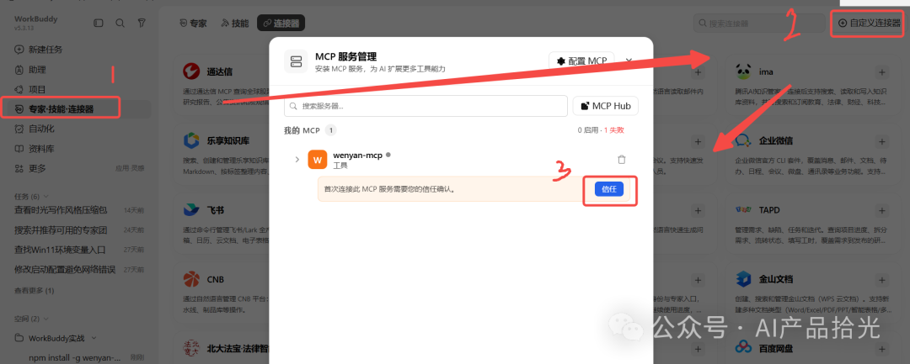
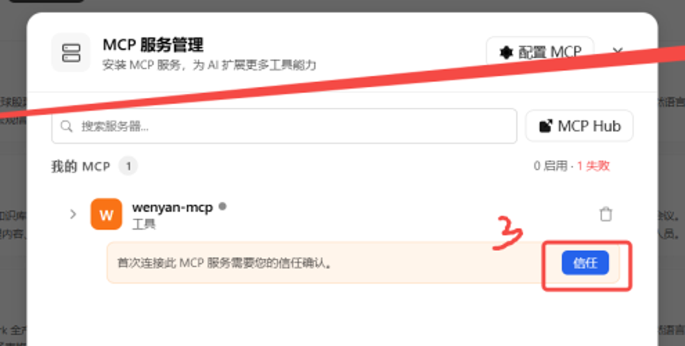

# (Forward Fashion) WorkIQ for AI Agent

將 Microsoft Work IQ 接入 WorkBuddy，讓 AI Agent 跨 Outlook、OneDrive、SharePoint、Teams 及會議內容搜尋、理解同整理公司資料。

**呢份 README 主要寫畀 AI Agent 閱讀。** AI Agent 應自行完成技術安裝；人類用戶只需要喺第一次登入時使用自己嘅公司帳號，並按 AI 提供嘅圖文指引重新啟動 WorkBuddy、啟用連接器及按 **Trust**。

> Repository slug：`forward-fashion-workiq-for-ai-agent`  
> Entra App：`WorkIQ for Agent`  
> WorkBuddy connector：`work-iq`  
> Version：1.0（2026-11-06）

---

## 1. Work IQ 係咩？

Work IQ 係 Microsoft hosted MCP 服務。呢個項目透過本機 stdio bridge，將 WorkBuddy 連接到：

```text
https://workiq.svc.cloud.microsoft/mcp
```

架構：

```text
WorkBuddy AI Agent
  → workiq-bridge.cmd / workiq_bridge.py
  → MSAL per-user token cache
  → Microsoft Work IQ hosted MCP
  → 使用者有權存取嘅 Microsoft 365 內容
```

主要用途：

- 用自然語言搵郵件、文件、Teams 討論及會議內容
- 唔記得檔案位置時，按內容語義搵 OneDrive／SharePoint 資料
- 跨來源整理項目背景、決定、問題及跟進事項
- 從會議逐字稿提取重點及行動項
- 為後續 m365-buddy 操作搵出正確郵件、檔案或會議

目前提供 12 個 MCP 工具：

| 類別 | 工具 |
|---|---|
| 搜尋及理解 | `search_paths`、`retrieve`、`ask`、`get_schema` |
| 讀取內容 | `fetch`、`fetch_blob` |
| Agents／functions | `list_agents`、`call_function` |
| 實體及動作 | `create_entity`、`update_entity`、`delete_entity`、`do_action` |

**重要：目前環境實測 Work IQ 主要適合搜尋及讀取。發郵件、建立行事曆項目等寫入操作曾被拒絕，唔好假設所有寫入工具都可用。**

---

## 2. AI Agent 應幾時用 Work IQ？

### 用 Work IQ

- 「搵之前 GLF 報價討論，唔記得邊個寄」
- 「OneDrive 邊份文件有最終設備清單？」
- 「上星期會議講咗咩？有咩行動項？」
- 「跨郵件、Teams 同文件整理 WFF 項目進度」
- 「最近有冇人提到 POS 印單問題？」

### 用 m365-buddy

- 已知寄件人、日期、主旨，需要精確列出郵件
- 已知 OneDrive 路徑或檔名，需要下載指定檔案
- 發郵件、建立 Outlook 草稿、回覆郵件
- 建立、修改或刪除 Outlook 行事曆項目
- 上傳、改名、移動或編輯指定檔案
- 查今日或下星期嘅準確會議安排

### 組合使用

```text
Work IQ 搵到相關背景或檔案
  → AI Agent 整理內容
  → m365-buddy 建立草稿、發送、下載或寫入
```

查「會議幾點」用 m365-buddy；查「會議講過咩」用 Work IQ。企業微信訊息操作唔屬於呢個項目。

---

## 3. 安全及權限邊界

AI Agent 必須遵守：

1. **每位用戶用自己嘅公司帳號登入。** 唔好共用其他人嘅 token cache。
2. Work IQ 使用 delegated 權限，只應存取登入用戶本來有權存取嘅內容。
3. 未經用戶明確指示，唔好發送郵件、修改檔案、刪除資料或執行其他外部寫入操作。
4. Token cache 係憑證，唔好上傳 GitHub、放入共享盤、經聊天發送或寫入日誌。
5. `client_id.txt` 只含 OAuth client ID，**唔係 client secret**；項目冇使用 client secret。
6. 預設 Entra App 只限公司 tenant，並啟用「需要使用者指派」。未獲指派嘅帳號唔可以因為下載咗 repo 而取得存取權。
7. 日常 WorkBuddy 調用唔應開瀏覽器；只有初次安裝或快取失效後重新執行安裝時先需要登入。

個人 token cache 預設位置：

```text
%USERPROFILE%\.workbuddy\workiq\msal_token_cache.bin
```

---

## 4. AI Agent 自動安裝 runbook

### 4.1 安裝原則

- **唔好叫人類用戶打開 Terminal、PowerShell、CMD 或手動輸入技術指令。**
- AI Agent 應使用自己嘅命令執行能力完成安裝。
- 將項目放喺本機固定、非同步資料夾；唔好放 Desktop、OneDrive 同步資料夾或 network drive。
- 使用絕對路徑執行腳本。
- 唔好覆蓋 WorkBuddy 嘅其他 MCP servers；內置 `install.py` 只會合併或更新 `work-iq` entry。

建議安裝位置：

```text
C:\Users\<username>\WorkBuddy\forward-fashion-workiq-for-ai-agent\
```

### 4.2 前置條件

AI Agent 先確認：

- Windows 版 WorkBuddy
- Python 3.9 或以上
- 網絡可連接 Microsoft login、Graph 及 Work IQ endpoint
- 用戶公司已開通 Work IQ
- 管理員已喺 **WorkIQ for Agent → Users and groups** 指派用戶或其群組

如果冇 Python，AI Agent 應透過該電腦核准嘅軟件安裝方式自行安裝或尋找現有 Python；唔好要求用戶手動執行安裝指令。

### 4.3 一個入口完成安裝

Windows 上由 AI Agent 執行：

```bat
agent_setup.cmd
```

或者由 AI Agent 使用已定位嘅 Python 執行：

```bash
python agent_setup.py
```

腳本會自動：

1. 檢查並安裝 `requirements.txt` 入面嘅 MSAL 依賴
2. 讀取項目內嘅 `client_id.txt`
3. 喺需要時打開瀏覽器
4. 驗證 Work IQ endpoint 回應 HTTP 200
5. 將 `work-iq` 合併寫入 `%USERPROFILE%\.workbuddy\mcp.json`
6. 輸出 JSON 安裝結果及後續 UI 步驟

**腳本冇 `pause`，唔需要人類按 Enter 繼續，亦唔會輸出 access token。**

### 4.4 唯一一次登入

如果瀏覽器開啟，AI Agent 只需同用戶講：

> 請喺啱啱開啟嘅瀏覽器，用你自己嘅公司 Microsoft 365 帳號登入。呢個係一次性登入，之後會靜默取得 token，唔會每次使用都開網頁。

呢個項目**唔使用 device code**。AI Agent 唔應叫用戶複製認證碼、編輯 JSON、設定環境變數或手動安裝 Python package。

---

## 5. AI Agent 引導用戶按 Trust

安裝成功後，AI Agent 應提供以下圖文指引，而唔係只丟一堆技術文字。

### 第一步：完全重新啟動 WorkBuddy

1. 喺 Windows 系統托盤搵到 WorkBuddy 圖示。
2. 選擇「退出」，再重新開啟 WorkBuddy。
3. 因為 WorkBuddy 會喺啟動時讀取 MCP 設定，所以必須完整重啟。

### 第二步：打開自定義連接器

進入左側「專家·技能·連接器」→「連接器」，再按右上角「自定義連接器」。



### 第三步：信任 work-iq

喺列表搵到 `work-iq`，按 **Trust**；狀態變成已啟用後，開一個新對話。



> 圖中 `wenyan-mcp` 係來源文章嘅示例；你實際要搵同信任嘅係 **`work-iq`**。不同 WorkBuddy 版本嘅按鈕位置可能略有差異，AI Agent 應以目前 UI 為準。
>
> 截圖來源：[WorkBuddy 入門教學（AI 产品拾光，經 ima.qq.com 公開內容）](https://ima.qq.com/wiki/?shareId=c515f7ce88aa5b4db27ede590c59c57c067b23af19a86c89160dd63bbb7446d3&mediaId=wechatarticle_5f1edcb4f787a4bb7c23e8d872a55179_6bee2ea4077caad0edf533d8acbe96107474013655809550&action=openDetailDrawer&webFrom=10000171)。第二張圖只裁剪同一來源以突出 Trust 按鈕。

AI Agent 可以同用戶講：

> 安裝已經完成。而家只需要完全重開 WorkBuddy，然後按圖中位置進入「自定義連接器」，搵到 `work-iq` 按 **Trust**。完成後開一個新對話，就可以使用。

---

## 6. 驗證安裝

AI Agent 可以自行執行，唔使用戶操作：

```bash
python signin.py --status
python signin.py --check
python workiq_bridge_test.py
python agent_setup.py --no-interactive
```

預期結果：

- `signin.py --status` 顯示正確 client ID 及目前用戶快取
- Work IQ endpoint 回應 HTTP 200
- `workiq_bridge_test.py` 成功 initialize、`tools/list` 回傳 12 個工具，並完成一次 live call
- `--no-interactive` 證明唔開瀏覽器都可以靜默取得 token

喺 WorkBuddy 新對話輸入：

```text
列出 work-iq 連接器下所有可用嘅工具
```

---

## 7. Troubleshooting 畀 AI Agent

### `AADSTS65001`／未同意或未獲授權

- 確認登入嘅係用戶自己嘅公司帳號
- 確認管理員已喺 Entra Enterprise application **WorkIQ for Agent** 指派該用戶或群組
- 唔好嘗試改用共用 token 繞過指派

### `Connection closed`／`Not connected`

- 確認 `%USERPROFILE%\.workbuddy\mcp.json` 有 `work-iq`
- 完全重啟 WorkBuddy
- 開新對話；舊對話未必會載入新 connector

### Token 快取失效

由 AI Agent 重新執行 `agent_setup.cmd`。用戶只需要再登入一次，唔使手動刪除檔案。

### MSAL 安裝失敗

- 檢查 Python 及 pip 是否正常
- 檢查網絡或公司 proxy
- 使用環境核准嘅 Python 套件安裝方式
- 唔好叫人類用戶自行複製 pip 指令

### Work IQ token 成功但 endpoint 拒絕

檢查公司 Work IQ 授權、用戶指派及網絡。唔好將其他 App 嘅 token 當作 WorkIQ for Agent token 使用。

---

## 8. 項目內容

| 檔案 | 用途 |
|---|---|
| `agent_setup.cmd` | AI Agent 首選 Windows 安裝入口，無 `pause` |
| `agent_setup.py` | 依賴、登入、endpoint 驗證及 MCP 註冊 |
| `requirements.txt` | Python 依賴 |
| `workiq_auth.py` | MSAL PKCE 登入、快取及靜默 token 取得 |
| `signin.py` | 登入狀態及 endpoint 檢查 |
| `workiq_bridge.py` | WorkBuddy stdio ↔ hosted Work IQ MCP |
| `workiq-bridge.cmd` | Bridge launcher |
| `install.py` | 合併寫入 WorkBuddy `mcp.json` |
| `workiq_bridge_test.py` | 端到端測試 |
| `client_id.txt` | 公司 Entra App client ID，非密碼 |
| `setup.cmd` | 人類互動式後備安裝入口；AI 應優先使用 `agent_setup.cmd` |
| `docs/images/` | AI Agent 用嚟引導用戶嘅 WorkBuddy 截圖 |

項目**唔包含**建立 Entra App 嘅管理員工具、管理員 token 或任何用戶 token cache。

---

## 9. 其他公司或 tenant 使用

呢個 repo 嘅預設 client ID 及 tenant 屬於 Forward Fashion。其他組織唔應直接重用呢個身份設定；應建立自己嘅單租戶 Entra App、設定 Work IQ delegated scopes、管理員同意及用戶指派，再更新：

- `client_id.txt`
- `workiq_auth.py` 入面嘅 tenant ID

公開 source code 唔等於公開 Forward Fashion 嘅資料存取權。
